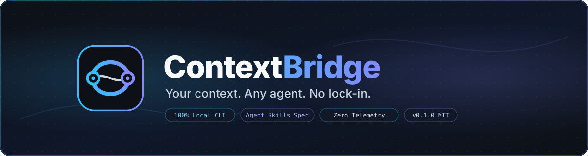
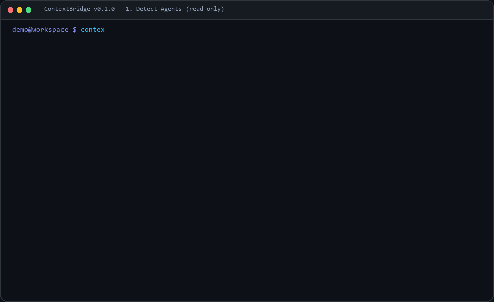
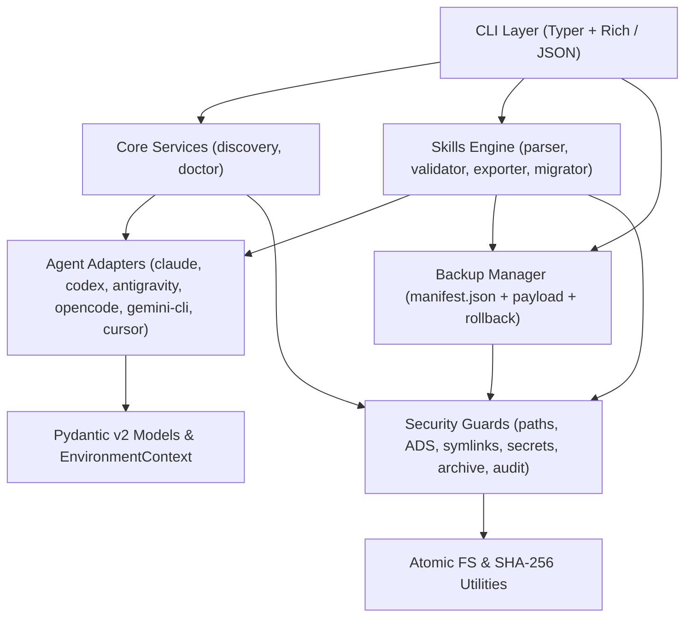

<p align="center">
  
</p>

<p align="center">
  <a href="LICENSE"></a>
  <a href="CHANGELOG.md"></a>
  <a href="pyproject.toml"></a>
  <a href="SECURITY.md"></a>
</p>

<p align="center">
  <strong>English</strong> · <a href="README.pt-BR.md">Português (Brasil)</a> ·
  <a href="docs/ARCHITECTURE.md">Architecture</a> ·
  <a href="docs/COMPATIBILITY.md">Compatibility</a> ·
  <a href="docs/RESEARCH.md">Research</a> ·
  <a href="docs/ROADMAP.md">Roadmap</a> ·
  <a href="SECURITY.md">Security</a>
</p>

---

**ContextBridge** is a universal, cross-platform, 100% local open-source CLI tool for discovering, validating, packaging, and safely migrating **Agent Skills** (`SKILL.md`) across AI coding agents—without telemetry, cloud accounts, or vendor lock-in.

> **Non-Affiliation Notice:** ContextBridge is an independent open-source project and is **not** officially affiliated with, endorsed by, or sponsored by Anthropic, OpenAI, Google, Cursor, or OpenCode.

## Live Demo (Synthetic Workspace)

<p align="center">
  
</p>

Reproduce this exact demo locally in an isolated temporary directory (never touching real agent configurations):

```bash
python examples/demo.py
```

## Quick Start

ContextBridge requires **Python 3.11 or newer**.

> **Distribution Status:** ContextBridge v0.1.0 is currently installed locally from source. It is **not** published on PyPI yet. When published in the future, the planned PyPI distribution name is **`contextbridge-agents`** (avoiding PEP 503 conflicts with existing `context-bridge` and `contextbridge-cli` packages) while keeping **`ContextBridge`** as the project identity and **`contextbridge`** as the CLI command.

```bash
# Clone the repository and enter the directory
python -m venv .venv

# Linux / macOS:
source .venv/bin/activate
# Windows (PowerShell):
.\.venv\Scripts\Activate.ps1

# Install locally
pip install -e .

# Verify CLI installation
contextbridge --version
contextbridge scan
contextbridge doctor
```

For development (tests, lint, strict typing, packaging):

```bash
pip install -e ".[dev]"
```

## Why ContextBridge?

Developers increasingly work across multiple AI coding agents—**Claude Code**, **OpenAI Codex**, **Google Antigravity**, **OpenCode**, **Gemini CLI**, and **Cursor**. While the open [Agent Skills specification](https://agentskills.io) standardizes `SKILL.md`, day-to-day management still has sharp edges:

- Each agent scans different native and compatibility directories (`.claude/skills`, `.agents/skills`, `.gemini/skills`, `.cursor/skills`, `.opencode/skills`, `~/.gemini/config/skills`).
- Shared directories cause duplicate counts and hidden precedence conflicts.
- Agent-specific frontmatter fields (such as Claude Code's `context: fork` or `disable-model-invocation`) may be silently ignored elsewhere.
- Manual folder copying risks silent overwrites, broken local links, symlink traps, or accidental leakage of `.env` files and credentials.

## Understanding Shared Directories & Physical Deduplication

Several agents scan the same physical directory on disk—most notably `<project>/.agents/skills` and `~/.agents/skills`, as well as `.claude/skills` compatibility paths read by OpenCode and Cursor.

- **Without deduplication**, a single skill stored in `~/.agents/skills/my-skill` would be counted up to **5 times** across Codex, Antigravity, OpenCode, Gemini CLI, and Cursor.
- **With ContextBridge**, skills are resolved to their canonical physical path and reported **once**, showing both primary/native agents and compatibility-only agents.
- **No-op detection**: If you migrate between two agents whose primary target resolves to the exact same physical directory, ContextBridge detects it cleanly as a no-op instead of self-overwriting.

## Command Reference

### 1. Detect Agents (Read-Only)

Distinguishes `installed + configured`, `installed (no config)`, `config found (CLI not on PATH)`, and `not found` without ever creating missing directories:

```bash
contextbridge scan
contextbridge scan --project-dir /path/to/repo
contextbridge scan --json
```

### 2. List Skills (Deduplicated, Read-Only)

```bash
contextbridge skills list
contextbridge skills list --agent claude
contextbridge skills list --scope project
contextbridge skills list --json
```

### 3. Validate a Skill (Agent Skills Spec + Heuristics)

Validates `SKILL.md` frontmatter, naming rules, directory match, local Markdown references, directory safety, and heuristic security checks without executing any scripts:

```bash
contextbridge skills validate ./examples/sample-skill
contextbridge skills validate ./my-skill --json
```

### 4. Export Portable ZIP Archive

Packages `SKILL.md`, `scripts/`, `references/`, and `assets/` into a deterministic, ZIP-safety-verified archive while blocking secrets, sensitive files, symlinks, and silent overwrites:

```bash
contextbridge skills export ./examples/sample-skill --format zip
contextbridge skills export ./examples/sample-skill --format zip --output ./sample-skill.zip
contextbridge skills export ./examples/sample-skill --format zip --output ./sample-skill.zip --overwrite
```

> **Format honesty:** Exports produce a standard Agent Skills ZIP layout for extraction into a target agent's skills directory. ContextBridge does not claim native one-click ZIP import where an agent does not officially document it.

### 5. Safe Dry-Run & Migration

Dry-run preview is **always the default**. Applying changes requires `--apply` plus interactive confirmation (or `--yes` in scripts), and replacing an existing destination requires `--overwrite` (always creating a verified local backup first):

```bash
# Step 1 — Preview plan (default dry-run; modifies nothing)
contextbridge skills migrate release-checklist --from claude --to codex

# Step 2 — Apply with interactive confirmation
contextbridge skills migrate release-checklist --from claude --to codex --apply

# Step 3 — Replace an existing destination safely (creates local backup first)
contextbridge skills migrate release-checklist --from claude --to codex --apply --overwrite --yes
```

> **Portability vs. runtime behavior:** Porting skill files preserves the Agent Skills directory structure, but does **not** guarantee identical runtime behavior, tool permissions, or invocation triggers across different agents.

### 6. Local Backups & Restoration

```bash
contextbridge backup list
contextbridge backup restore <BACKUP_ID>            # Dry-run preview + SHA-256 check
contextbridge backup restore <BACKUP_ID> --apply    # Atomic restore with pre-restore snapshot
```

### 7. Read-Only Diagnostics

```bash
contextbridge doctor
contextbridge doctor --json
```

## Offline context transfer (v0.2.0 development)

Inspect a CBCF document, preview a handoff, or write a portable artifact into an existing directory.

```bash
contextbridge context inspect examples/context-handoff.cbcf.json --json
contextbridge context export --from claude --source ./session.jsonl --output ./session.cbcf.json --dry-run
contextbridge context convert examples/context-handoff.cbcf.json --to-format handoff-md --output ./handoff.md
contextbridge context import examples/context-handoff.cbcf.json --to codex --format cbcf --apply
```

Export and conversion accept repeatable `--include` and `--exclude` options. Import previews by default and `--apply` writes a portable handoff. Inputs are explicit files, including OpenCode session export JSON and Gemini CLI session JSON or JSONL. Codex, Antigravity, and Cursor accept manually prepared CBCF. All operations are offline and exports redact potential secrets. See [CBCF and command options](docs/CONTEXT_FORMAT.md) and [local format compatibility](docs/PROVIDER_COMPATIBILITY.md#3-coding-agent-local-session--context-capabilities).

## Compatibility Matrix (v0.1.0)

| Agent | Adapter ID | Project Skills Paths | Global Skills Paths | Env Override |
| --- | --- | --- | --- | --- |
| **Claude Code** | `claude` | `.claude/skills` | `~/.claude/skills` | `CLAUDE_CONFIG_DIR` |
| **OpenAI Codex** | `codex` | `.agents/skills` | `~/.agents/skills`, `~/.codex/skills` | `CODEX_HOME` |
| **Google Antigravity** | `antigravity` | `.agents/skills`, `.agent/skills` | `~/.gemini/config/skills`, `~/.gemini/antigravity/skills`, `~/.agents/skills` | — |
| **OpenCode** | `opencode` | `.opencode/skills`, `.agents/skills`, `.claude/skills` | `~/.config/opencode/skills`, `~/.agents/skills`, `~/.claude/skills` | `OPENCODE_CONFIG_DIR`, `XDG_CONFIG_HOME` |
| **Gemini CLI** | `gemini-cli` | `.gemini/skills`, `.agents/skills` | `~/.gemini/skills`, `~/.agents/skills` | `GEMINI_CLI_HOME` |
| **Cursor** | `cursor` | `.cursor/skills`, `.agents/skills`, `.claude/skills`, `.codex/skills` | `~/.cursor/skills`, `~/.agents/skills`, `~/.claude/skills`, `~/.codex/skills` | — |

See [docs/COMPATIBILITY.md](docs/COMPATIBILITY.md) for verified details, frontmatter portability, and pending items.

## Architecture



See [docs/ARCHITECTURE.md](docs/ARCHITECTURE.md) for full module boundaries and exit codes.

## Security Mechanisms

ContextBridge is **safe by default** and operates **100% locally with zero telemetry**:

- **Zero execution of untrusted content**: Never runs scripts in `scripts/`, never starts MCP servers, and never loads external plugins as Python code.
- **Strict filesystem & archive guards**: Rejects path traversal (`..`), symlinks and Windows junctions, NTFS Alternate Data Streams (`:`), Windows reserved device names (`CON`, `NUL`, `COM1..9`, `LPT1..9`), trailing dot/space filename tricks, case-insensitive path collisions, ZIP Slip, ZIP bombs, and oversized files.
- **Hardened YAML parsing**: Uses a strict `yaml.SafeLoader` subclass that rejects duplicate mapping keys, excessive nesting depth, and alias/anchor expansion bombs.
- **Credential & secret blocking**: Blocks sensitive files/directories (`.env`, `.ssh/*`, `.aws/*`, `.git-credentials`, `*.pem`, `*.key`, `credentials.json`, etc.) and alerts on heuristic token patterns **without ever printing or logging matched values**.
- **Authorized restore boundaries & TOCTOU protection**: Restores enforce authorized destination rules independently of `manifest.json` (blocking tampered manifests, skills root directories, ancestors, system paths, and non-empty non-skill directories). Migrations re-verify both source and destination state between planning and applying, and preserve displaced/backup files if rollback itself fails.

> **Important Security Disclaimers:**
> 1. Static secret and command checks are **heuristic aids only** and cannot guarantee that an untrusted skill is free of malicious intent or prompt injection.
> 2. Local SHA-256 digests in `manifest.json` verify **integrity against corruption, partial writes, and drift**; because manifests are unsigned, they are **not** a cryptographic authenticity guarantee against an attacker who already holds local write access to `~/.contextbridge/backups`.

See [SECURITY.md](SECURITY.md) for responsible disclosure guidance.

## Transparent Limitations (v0.1.0)

- **Tested locally on Windows (Python 3.15.2)**: Linux, macOS, and Python 3.11–3.14 are configured in `.github/workflows/ci.yml`, but local verification of v0.1.0 was performed on Windows only.
- **Custom agent manifests not parsed yet**: Codex `[[skills.config]]` in `config.toml`, Antigravity `skills.json` / `_agents/`, Cursor nested monorepo `.cursor/skills`, and Gemini CLI `/trust` / extension-bundled skills are documented as pending.
- **Read-only permission check on Windows**: `doctor` uses non-mutating `os.access` checks, which are best-effort on Windows NTFS ACLs.
- **File portability ≠ identical runtime behavior**: Agents enforce different tool approval flows and frontmatter extensions.

## Roadmap

### Implemented in v0.1.0
- Read-only detection for 6 AI coding agents (`scan`)
- Physically deduplicated skill listing (`skills list`)
- Official Agent Skills specification validator + static heuristic audit (`skills validate`)
- Safe deterministic ZIP export (`skills export --format zip`)
- Transactional 10-step migration with dry-run default, TOCTOU guards, backup, and rollback (`skills migrate`)
- Local backups with SHA-256 integrity checks and authorized restoration (`backup list`, `backup restore`)
- Read-only diagnostics (`doctor`)

### Planned for Future Versions (Not Implemented in v0.1.0)
- MCP server configuration migration
- Conversion between `AGENTS.md`, `CLAUDE.md`, and `GEMINI.md`
- Cross-agent synchronization & redundancy detection
- Context compaction & cross-session context transfer
- Profile management, advanced static security auditing, and optional GUI

See [docs/ROADMAP.md](docs/ROADMAP.md) for details.

## Contributing

Contributions are welcome! Please review [CONTRIBUTING.md](CONTRIBUTING.md), [AGENTS.md](AGENTS.md), and [CODE_OF_CONDUCT.md](CODE_OF_CONDUCT.md) before opening an issue or pull request.

## License

Released under the [MIT License](LICENSE).
