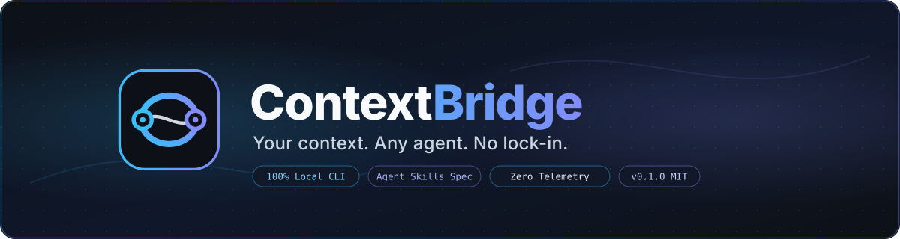
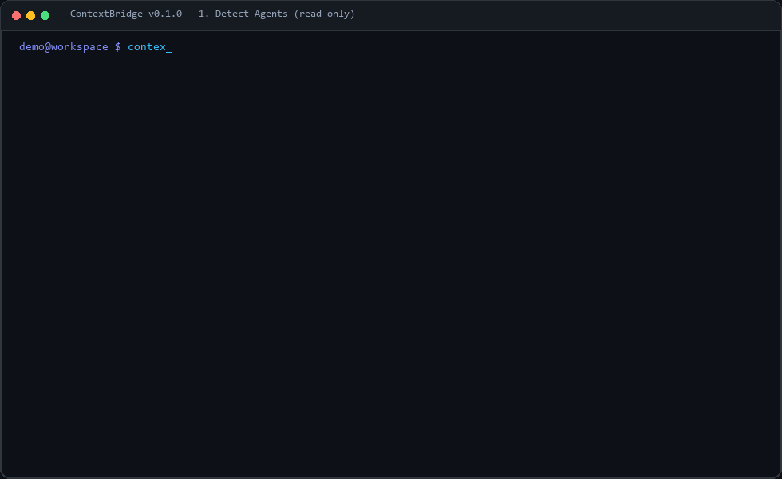
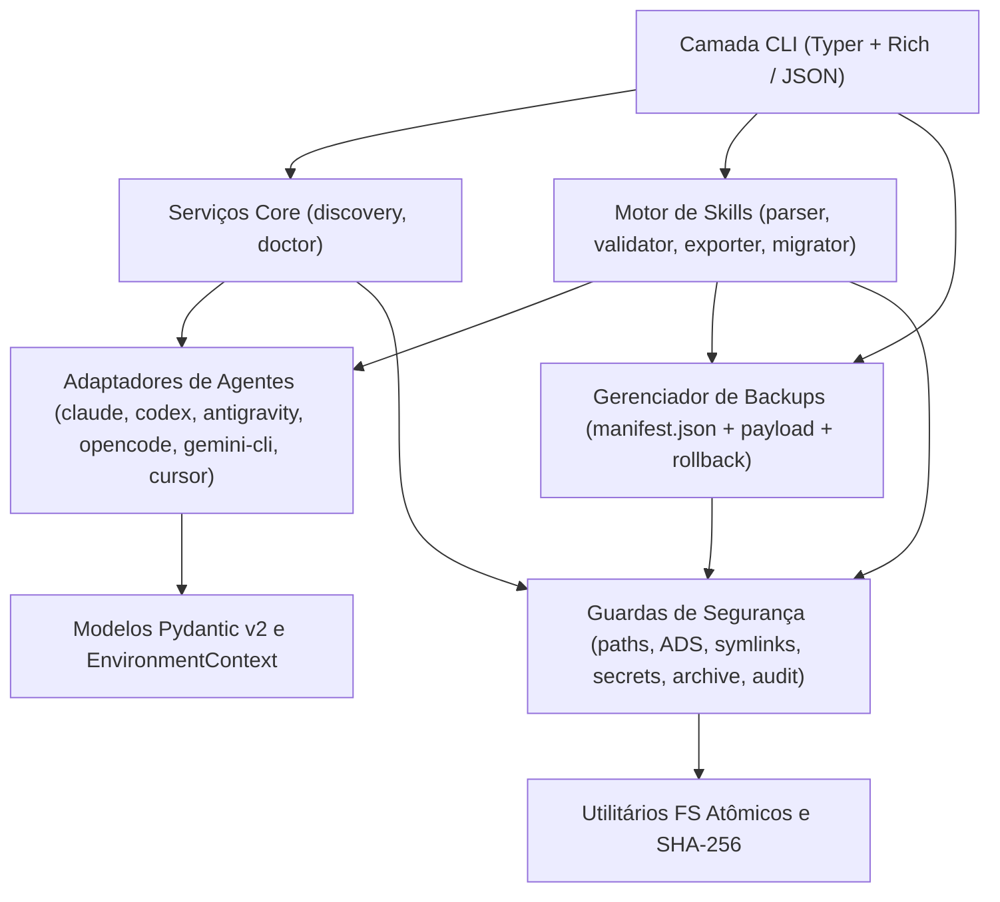

<p align="center">
  
</p>

<p align="center">
  <a href="LICENSE"></a>
  <a href="CHANGELOG.md"></a>
  <a href="https://github.com/AlemaoBoy/ContextBridge/actions/workflows/ci.yml?query=branch%3Amain"></a>
  <a href="https://github.com/AlemaoBoy/ContextBridge/actions/workflows/ci.yml?query=branch%3Adevelop"></a>
  <a href="pyproject.toml"></a>
  <a href="SECURITY.md"></a>
</p>

<p align="center">
  <a href="README.md">English</a> · <strong>Português (Brasil)</strong> ·
  <a href="docs/ARCHITECTURE.md">Arquitetura</a> ·
  <a href="docs/COMPATIBILITY.md">Compatibilidade</a> ·
  <a href="docs/RESEARCH.md">Pesquisa Técnica</a> ·
  <a href="docs/ROADMAP.md">Roadmap</a> ·
  <a href="SECURITY.md">Segurança</a>
</p>

---

**ContextBridge** é uma ferramenta CLI universal, multiplataforma, 100% local e open source para descobrir, validar, empacotar e migrar **Agent Skills** (`SKILL.md`) entre agentes de programação baseados em IA — sem telemetria, sem contas em nuvem e sem lock-in.

> **Aviso de não afiliação:** O ContextBridge é um projeto open source independente e **não** possui afiliação oficial, patrocínio ou endosso da Anthropic, OpenAI, Google, Cursor ou OpenCode.

## Demonstração (Ambiente Sintético)

<p align="center">
  
</p>

Reproduza esta mesma demonstração localmente em um diretório temporário isolado (sem tocar em configurações reais da sua máquina):

```bash
python examples/demo.py
```

## Quick Start

O ContextBridge requer **Python 3.11 ou superior**.

A branch `main` contém o baseline da v0.1.0 com as verificações da Fase 2A. A branch [`develop`](https://github.com/AlemaoBoy/ContextBridge/tree/develop) contém a v0.2.0 em desenvolvimento.

> **Status de distribuição:** A versão v0.1.0 está disponível para instalação local a partir do código-fonte e **ainda não está publicada no PyPI**. Para futura publicação no PyPI, o nome exclusivo de distribuição definido é **`contextbridge-agents`** (evitando conflitos PEP 503 com os pacotes já existentes `context-bridge` e `contextbridge-cli`), mantendo **`ContextBridge`** como identidade do projeto e **`contextbridge`** como comando CLI.

```bash
# Clone o repositório e entre no diretório do projeto
python -m venv .venv

# Linux / macOS:
source .venv/bin/activate
# Windows (PowerShell):
.\.venv\Scripts\Activate.ps1

# Instale localmente
pip install -e .

# Verifique a instalação
contextbridge --version
contextbridge scan
contextbridge doctor
```

Para desenvolvimento (testes, lint, tipagem estrita e empacotamento):

```bash
pip install -e ".[dev]"
```

## Problema Resolvido

Desenvolvedores alternam cada vez mais entre múltiplos agentes — **Claude Code**, **OpenAI Codex**, **Google Antigravity**, **OpenCode**, **Gemini CLI** e **Cursor**. Mesmo com a adoção da especificação aberta [Agent Skills](https://agentskills.io), a operação diária ainda apresenta atritos:

- Cada agente usa diretórios nativos e de compatibilidade diferentes (`.claude/skills`, `.agents/skills`, `.gemini/skills`, `.cursor/skills`, `.opencode/skills`, `~/.gemini/config/skills`).
- Diretórios compartilhados causam contagem duplicada e conflitos silenciosos de precedência.
- Campos específicos de um agente (como `context: fork` ou `disable-model-invocation` no Claude Code) podem ser ignorados silenciosamente em outros agentes.
- Copiar pastas manualmente traz risco de sobrescritas silenciosas, links locais quebrados, symlinks perigosos ou vazamento de arquivos `.env` e credenciais.

## Diretórios Compartilhados e Deduplicação Física

Vários agentes leem o mesmo diretório físico — em especial `<projeto>/.agents/skills` e `~/.agents/skills`, além de caminhos de compatibilidade `.claude/skills` lidos por OpenCode e Cursor.

- **Sem deduplicação**, uma única skill em `~/.agents/skills/minha-skill` seria contada até **5 vezes** entre Codex, Antigravity, OpenCode, Gemini CLI e Cursor.
- **Com o ContextBridge**, cada skill é normalizada pelo caminho físico canônico e exibida **uma única vez**, distinguindo agentes nativos/primários de agentes de compatibilidade.
- **Detecção de no-op**: Ao migrar entre dois agentes cujo destino primário aponta para o mesmo diretório físico, o ContextBridge informa que nenhuma cópia é necessária em vez de sobrescrever a própria origem.

## Exemplos de Comandos

### 1. Detecção de Agentes (Somente Leitura)

Diferencia `installed + configured`, `installed (no config)`, `config found (CLI not on PATH)` e `not found`, sem nunca criar diretórios ausentes:

```bash
contextbridge scan
contextbridge scan --project-dir /caminho/do/repositorio
contextbridge scan --json
```

### 2. Listagem de Skills (Deduplicada, Somente Leitura)

```bash
contextbridge skills list
contextbridge skills list --agent claude
contextbridge skills list --scope project
contextbridge skills list --json
```

### 3. Validação (Especificação Agent Skills + Heurísticas)

Valida frontmatter YAML, regras de nome e correspondência com o diretório, referências Markdown locais, segurança de arquivos e verificações estáticas heurísticas sem executar scripts:

```bash
contextbridge skills validate ./examples/sample-skill
contextbridge skills validate ./minha-skill --json
```

### 4. Exportação em ZIP Portátil

Empacota `SKILL.md`, `scripts/`, `references/` e `assets/` em um ZIP determinístico verificado contra falhas de segurança, bloqueando segredos, credenciais, symlinks e sobrescrita silenciosa:

```bash
contextbridge skills export ./examples/sample-skill --format zip
contextbridge skills export ./examples/sample-skill --format zip --output ./sample-skill.zip
contextbridge skills export ./examples/sample-skill --format zip --output ./sample-skill.zip --overwrite
```

> **Transparência sobre formato:** O ZIP gerado segue o layout portátil Agent Skills para extração manual no diretório de skills do agente de destino. O ContextBridge não afirma instalação automática nativa por ZIP em agentes que não documentam oficialmente esse recurso.

### 5. Prévia (Dry-Run) e Migração Segura

A prévia (`--dry-run`) é **sempre o padrão**. Aplicar alterações exige `--apply` e confirmação interativa (ou `--yes`), e substituir um destino existente exige `--overwrite` (sempre criando backup local antes):

```bash
# Passo 1 — Prévia do plano (dry-run padrão; não altera nada)
contextbridge skills migrate release-checklist --from claude --to codex

# Passo 2 — Aplicar com confirmação interativa
contextbridge skills migrate release-checklist --from claude --to codex --apply

# Passo 3 — Substituir destino existente com segurança (gera backup local antes)
contextbridge skills migrate release-checklist --from claude --to codex --apply --overwrite --yes
```

> **Portabilidade vs. comportamento em runtime:** Migrar arquivos preserva o formato Agent Skills, mas **não garante comportamento idêntico**, permissões de ferramentas ou gatilhos de invocação entre agentes diferentes.

### 6. Backups Locais e Restauração

```bash
contextbridge backup list
contextbridge backup restore <BACKUP_ID>            # Prévia + verificação SHA-256
contextbridge backup restore <BACKUP_ID> --apply    # Restauração atômica com snapshot prévio
```

### 7. Diagnóstico (Somente Leitura)

```bash
contextbridge doctor
contextbridge doctor --json
```

## Matriz de Compatibilidade (v0.1.0)

| Agente | ID | Diretórios de Projeto | Diretórios Globais | Variáveis de Ambiente |
| --- | --- | --- | --- | --- |
| **Claude Code** | `claude` | `.claude/skills` | `~/.claude/skills` | `CLAUDE_CONFIG_DIR` |
| **OpenAI Codex** | `codex` | `.agents/skills` | `~/.agents/skills`, `~/.codex/skills` | `CODEX_HOME` |
| **Google Antigravity** | `antigravity` | `.agents/skills`, `.agent/skills` | `~/.gemini/config/skills`, `~/.gemini/antigravity/skills`, `~/.agents/skills` | — |
| **OpenCode** | `opencode` | `.opencode/skills`, `.agents/skills`, `.claude/skills` | `~/.config/opencode/skills`, `~/.agents/skills`, `~/.claude/skills` | `OPENCODE_CONFIG_DIR`, `XDG_CONFIG_HOME` |
| **Gemini CLI** | `gemini-cli` | `.gemini/skills`, `.agents/skills` | `~/.gemini/skills`, `~/.agents/skills` | `GEMINI_CLI_HOME` |
| **Cursor** | `cursor` | `.cursor/skills`, `.agents/skills`, `.claude/skills`, `.codex/skills` | `~/.cursor/skills`, `~/.agents/skills`, `~/.claude/skills`, `~/.codex/skills` | — |

Consulte [docs/COMPATIBILITY.md](docs/COMPATIBILITY.md) para detalhes completos, portabilidade de frontmatter e itens pendentes.

## Arquitetura



Mais detalhes em [docs/ARCHITECTURE.md](docs/ARCHITECTURE.md).

## Mecanismos de Segurança

O ContextBridge é **seguro por padrão** e opera **100% localmente, sem telemetria**:

- **Zero execução de conteúdo de terceiros**: Nunca executa scripts em `scripts/`, nunca inicia servidores MCP e nunca carrega plugins externos como código Python.
- **Proteções rígidas de sistema de arquivos e arquivos ZIP**: Rejeita path traversal (`..`), symlinks e junctions do Windows, NTFS Alternate Data Streams (`:`), nomes reservados do Windows (`CON`, `NUL`, `COM1..9`, `LPT1..9`), sufixos com ponto/espaço, colisões case-insensitive, ZIP Slip, ZIP bombs e arquivos excessivamente grandes.
- **Parsing YAML endurecido**: Subclasse estrita de `yaml.SafeLoader` que rejeita chaves duplicadas, profundidade excessiva e bombas de anchors/aliases.
- **Bloqueio de credenciais e segredos**: Bloqueia arquivos e pastas sensíveis (`.env`, `.ssh/*`, `.aws/*`, `.git-credentials`, `*.pem`, `*.key`, `credentials.json`, etc.) e emite alertas heurísticos **sem nunca exibir ou registrar valores de segredos**.
- **Restauração autorizada e proteção TOCTOU**: Restaurações validam destinos autorizados de forma independente do `manifest.json` (bloqueando manifestos adulterados, raízes de skills, diretórios ancestrais, caminhos de sistema e diretórios não vazios que não sejam skills). Migrações revalidam origem e destino entre planejamento e aplicação e preservam arquivos deslocados e backups caso o próprio rollback falhe.

> **Avisos Importantes de Segurança:**
> 1. Verificações estáticas de segredos e comandos são **heurísticas** e não garantem que uma skill externa esteja livre de comportamento malicioso ou *prompt injection*.
> 2. Os hashes SHA-256 em `manifest.json` verificam **integridade contra corrupção acidental, escrita parcial e divergência**; como os manifestos locais não são assinados criptograficamente, eles **não** constituem garantia de autenticidade contra um atacante que já possua permissão de escrita em `~/.contextbridge/backups`.

Consulte [SECURITY.md](SECURITY.md) para a política de relato responsável de vulnerabilidades.

## Limitações Transparentes (v0.1.0)

- **Testado localmente em Windows (Python 3.15.2)**: Linux, macOS e Python 3.11–3.14 estão configurados em `.github/workflows/ci.yml`, mas a execução local desta versão ocorreu exclusivamente em Windows.
- **Configurações avançadas ainda não lidas**: Entradas `[[skills.config]]` no `config.toml` do Codex, `skills.json` / `_agents/` do Antigravity, diretórios aninhados de monorepo no Cursor e estado `/trust` ou skills de extensões do Gemini CLI permanecem pendentes.
- **Checagem de permissão em Windows**: `doctor` usa `os.access` (não mutante), que oferece verificação aproximada sobre ACLs NTFS no Windows.
- **Portabilidade de arquivos ≠ comportamento idêntico**: Cada agente aplica suas próprias regras de aprovação de ferramentas e extensões de frontmatter.

## Roadmap

### Implementado na v0.1.0
- Detecção somente leitura para 6 agentes de programação (`scan`)
- Listagem deduplicada por caminho físico (`skills list`)
- Validador conforme a especificação oficial Agent Skills + auditoria estática heurística (`skills validate`)
- Exportação segura em ZIP determinístico (`skills export --format zip`)
- Migração transacional em 10 etapas com dry-run padrão, guardas TOCTOU, backup e rollback (`skills migrate`)
- Backups locais com integridade SHA-256 e restauração autorizada (`backup list`, `backup restore`)
- Diagnóstico somente leitura (`doctor`)

### Planejado para Versões Futuras (Não Implementado na v0.1.0)
- Migração de servidores MCP
- Conversão entre `AGENTS.md`, `CLAUDE.md` e `GEMINI.md`
- Sincronização entre agentes e detecção de redundância
- Compactação e transferência de contexto entre sessões
- Gerenciamento de perfis, auditoria estática avançada e interface gráfica (GUI)

Consulte [docs/ROADMAP.md](docs/ROADMAP.md) para mais detalhes.

## Como Contribuir

Contribuições são bem-vindas! Leia [CONTRIBUTING.md](CONTRIBUTING.md), [AGENTS.md](AGENTS.md) e [CODE_OF_CONDUCT.md](CODE_OF_CONDUCT.md) antes de abrir uma issue ou pull request.

## Licença

Distribuído sob a [Licença MIT](LICENSE).
